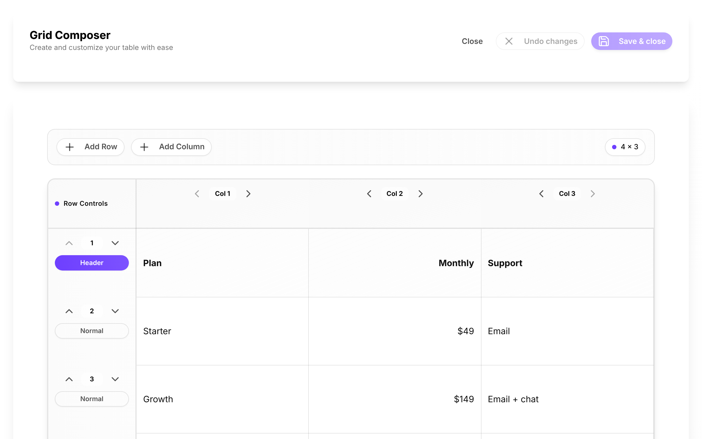

# Grid Composer

A Sitecore Marketplace app that gives content authors a real table editor inside the SitecoreAI Page builder. No more pasting tables into rich text and hoping the markup survives. Authors add, move and remove rows and columns, mark header rows, set alignment and font weight per cell, and the table is saved to the field as clean JSON that your head app renders with your own markup and styles.

It runs as a **Page builder custom field** extension, so it shows up wherever you add the field to a template.



## Features

- Add, insert, remove and reorder rows and columns
- Click a cell to edit it inline (Enter saves, Escape cancels)
- Toggle any row as a header row
- Per-cell horizontal and vertical alignment and font weight
- Unsaved-changes indicator that tracks actual content, so undoing an edit by hand clears it
- Invalid or empty field values start a fresh 3x3 table instead of breaking

## Field value

The field stores versioned JSON:

```json
{
  "version": "1.0",
  "columns": [{ "id": "c1" }, { "id": "c2" }],
  "rows": [
    {
      "id": "r1",
      "isHeader": true,
      "cells": [
        { "id": "a", "content": "Plan", "format": { "fontWeight": "bold" } },
        { "id": "b", "content": "Monthly", "format": { "align": "right" } }
      ]
    },
    {
      "id": "r2",
      "cells": [
        { "id": "c", "content": "Starter" },
        { "id": "d", "content": "$49", "format": { "align": "right" } }
      ]
    }
  ],
  "settings": { "hasHeaderRow": true, "hasBorders": true, "isStriped": false },
  "metadata": { "modified": "2026-11-26T18:00:00.000Z" }
}
```

Every row has exactly one cell per column. Cell content is plain text, and the example renderer outputs it as text, not HTML. The full types and helpers (`parseTableData`, `validateTableData`, `createEmptyTable`) live in [`lib/types/table.ts`](lib/types/table.ts).

## Rendering it in your head app

[`examples/content-sdk/GridTable.tsx`](examples/content-sdk/GridTable.tsx) is a drop-in Content SDK (Next.js) component. It works as a server component, outputs a semantic `<table>` with `<caption>`, `<thead>` and `scope="col"` headers, only lets plain color values into inline styles, and wraps the table in a horizontal scroll container for small screens.

Copy it into your app, register it in your component map, and rename the `Table` field in the props type to match your template.

## Getting started

Requirements: Node.js 20.9 or later (Next.js 16), access to the Sitecore Cloud Portal, and a SitecoreAI environment.

```bash
npm install
npm run dev        # http://localhost:3000
```

The app only works inside SitecoreAI. Opened directly in a browser it shows a "has to run inside SitecoreAI" message, which is expected.

To try it in SitecoreAI:

1. Register a custom app in the Cloud Portal and point it at your URL (your local dev server for development, your deployed URL after that). See [Custom Marketplace apps](https://doc.sitecore.com/mp/en/developers/marketplace/custom-marketplace-apps.html).
2. Enable the **Page builder custom field** extension point for the app and install it in your organization.
3. Add a field to your template with type **Marketplace Types > Plugin** and set its **Source** to your Marketplace app ID, then reload the Page builder. See [Enable a custom field in the SitecoreAI Page builder](https://doc.sitecore.com/mp/en/developers/marketplace/enable-a-custom-field-in-the-sitecoreai-page-builder.html).

## Scripts

| Script | What it does |
| --- | --- |
| `npm run dev` | Local dev server |
| `npm run build` | Production build |
| `npm run lint` | ESLint (Next.js core web vitals + TypeScript rules) |
| `npm run typecheck` | `tsc --noEmit` |

## Deploying

It's a standard Next.js app, so Vercel works out of the box: import the repo, deploy, then put the production URL in your app registration in the Cloud Portal. Any host that runs Next.js 16 is fine.

## Project layout

```
app/                       layout (wraps everything in MarketplaceProvider) and page
components/grid-composer/  field component, table builder, editable cell, format toolbar
components/providers/      Marketplace SDK connection (retry, error state, field value helpers)
components/ui/             Blok / shadcn UI primitives
lib/types/table.ts         field JSON types and helpers
examples/content-sdk/      rendering component for your head app (not part of this build)
```

## How it talks to Sitecore

`components/providers/marketplace.tsx` initializes `ClientSDK` once per tab with the `XMC` module, queries `application.context`, and retries a few times before showing an error with a "Try again" button. The field component then uses:

- `client.getValue()` to load the current field value (string or object, both handled)
- `client.setValue(json, true)` to save it and reload the Page builder canvas
- `client.closeApp()` to close the field dialog after saving, same as the Sitecore custom field sample

## Ideas for contributors

- CSV paste and import/export
- Cell merging (colspan/rowspan)
- Column widths in the editor
- Caption, striped and bordered toggles in the UI (already in the JSON schema)
- Keyboard navigation between cells

## Contributing

Issues and pull requests are welcome. See [CONTRIBUTING.md](CONTRIBUTING.md).

## License

[MIT](LICENSE)
